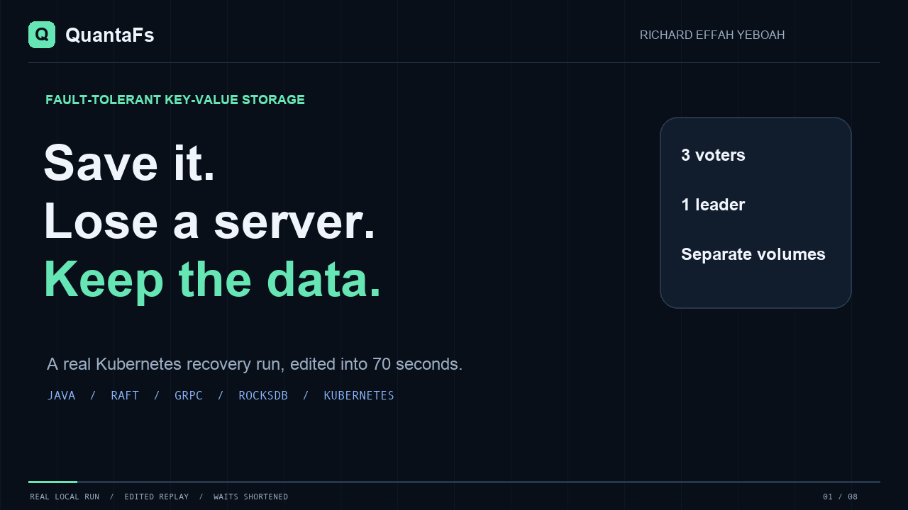

# QuantaFs recovery demo

[Watch the 70-second video](https://github.com/user-attachments/assets/09bb0814-8f3d-41e4-a314-b02a347fb36b)

[Download the MP4](quantafs-demo.mp4) · [Animated preview](quantafs-demo-preview.gif) ·
[Captured commands/results](demo-evidence/trace.json) · [Test transcript](demo-evidence/transcript.txt)



## What you are watching

A silent, captioned **edited replay** of an actual local Kubernetes run, captured on October 20,
2026. It is an annotated presentation of real command results, not a screen recording. Terminal
commands are abbreviated for legibility; Pod/PVC identities, request results, and status values
come from `demo-evidence/trace.json`. The capture must pass its checks before the renderer runs.

The eight chapters show the problem, a successful write/read, leader Pod deletion, another
successful write/read, changed Pod identity with the same persistent storage, refusal of a read
without a majority, restored data and matching applied indexes, and a concise closing summary.

Real waits are shortened. No sub-second failover time, production availability, host-failure
survival, independent backups, or security guarantee is implied. All three voters run on one
Docker Desktop Kubernetes host. TLS and authentication remain future work. The video has burned-in
captions and no soundtrack, so it can be understood without audio.

## Reproduce the capture

Start the verified local deployment using [the walkthrough](../kubernetes-walkthrough.md), then:

```bash
python3 scripts/capture-demo.py
```

This takes the same exclusion lock as the benchmark/recovery tools, runs the existing recovery
demo, records actual commands and responses, and preserves PVCs. It leaves three voters running.
The output files describe the most recent capture, so commit a new video/evidence set together.

## Reproduce the edit

The renderer requires Pillow, imageio-ffmpeg (which supplies FFmpeg), and the macOS Arial/Andale Mono
fonts used by this edition. Use a dedicated environment rather than changing project Java dependencies:

```bash
python3 -m venv /tmp/quantafs-video-env
/tmp/quantafs-video-env/bin/pip install Pillow imageio-ffmpeg
/tmp/quantafs-video-env/bin/python scripts/render-demo-video.py
```

The result is a 1280x720 H.264 MP4 at 20 fps, a lightweight GIF preview, chapter metadata, and ignored
chapter review frames. `hosting.json` records the current GitHub video URL and SHA-256 of the exact
uploaded MP4. Re-upload a new edit before changing that URL/hash. The versioned MP4 remains an
independent copy if the hosted attachment changes.
